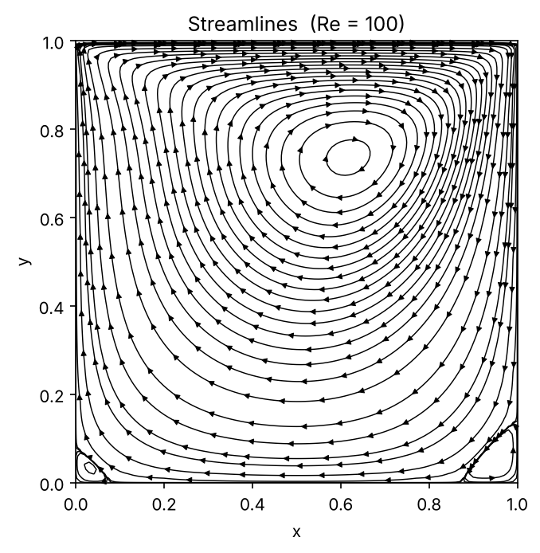
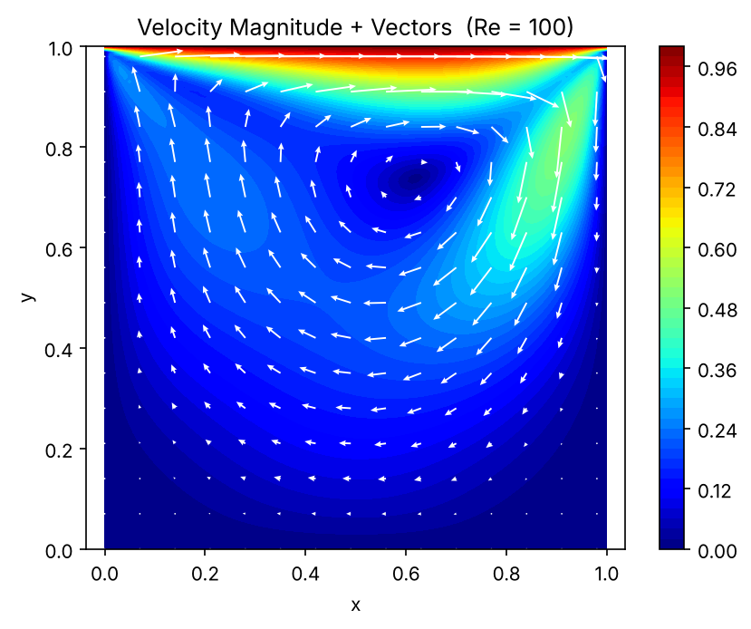
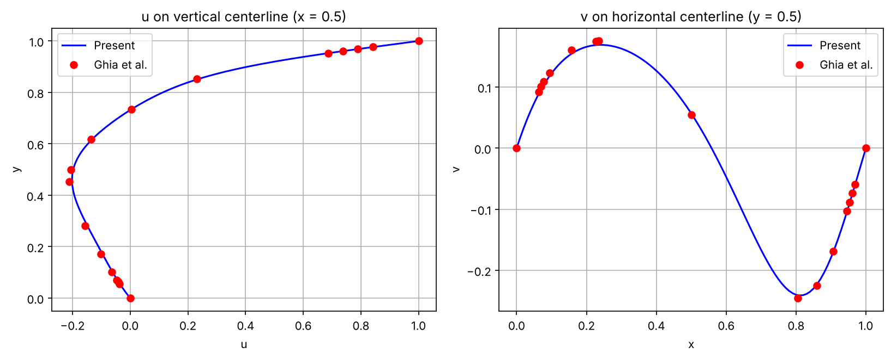

# Lid-Driven Cavity Solver (Python)

A Python program that simulates fluid flow inside a square box whose top lid
slides to the right. It solves the Navier-Stokes equations with the **SIMPLE
algorithm** and **central differences**, and checks the answer against the
standard benchmark of **Ghia et al. (1982)** at Reynolds number 100.

<p align="center">
  
  
</p>

## Objectives

1. Convert my MATLAB cavity solver (`LDC_CDS.m`) to Python.
2. Solve the flow at Re = 100 on a 101 × 101 grid.
3. Compare the result with Ghia et al. (1982).
4. Plot streamlines, velocity, centerline profiles and convergence.
5. Make the project installable with pip.

## Requirements

- Python 3.9 or newer ([download](https://www.python.org/downloads/))
- NumPy and Matplotlib (installed in step 2 below)

## How to run

**1. Download the project.** On GitHub, click **Code → Download ZIP** and
extract it.

**2. Open a terminal in the `ldc-cds` folder** and install the libraries:

```bash
pip install -r requirements.txt
```

**3. Run the program:**

```bash
python ldc_cds.py
```

**Windows:** if `pip` or `python` is "not recognized", use
`py -m pip install -r requirements.txt` and `py ldc_cds.py` instead.

The run takes about a minute. It ends by printing:

```
Steady state reached at step 9245  (t = 9.245)

Centerline check vs Ghia (Re = 100):
  max |u_present - u_Ghia| = 0.0094
  max |v_present - v_Ghia| = 0.0068
```

Then four plot windows open, and all results are saved in the `results`
folder.

### Or install it with pip

```bash
pip install git+https://github.com/YOUR-GITHUB-USERNAME/ldc-cds.git
ldc-cds
```

The `ldc-cds` command runs the same program from any folder. (Needs
[Git](https://git-scm.com/downloads).)

## Changing the settings

Open `ldc_cds.py` and edit **section 1** at the top, for example:

```python
re = 100     # Reynolds number
n  = 101     # grid points in each direction (keep it odd)
dt = 0.001   # time step
```

Save the file and run it again. If you increase Re, also increase n
(n ≥ Re/2 + 1). See [THEORY.md](THEORY.md#10-numerical-limits) for the limits.

## Files

| File / folder | What it is |
|---|---|
| `ldc_cds.py` | the program |
| `requirements.txt` | libraries needed |
| `data/ghia_1982_re100.csv` | benchmark data from Ghia et al. (1982), Re = 100 |
| `results/` | plots (PNG) and data (CSV) produced by the program |
| `THEORY.md` | the method and equations explained |
| `pyproject.toml` | makes the project pip installable |

## Results

Present solution vs Ghia et al. (101 × 101 grid):

| | Largest error |
|---|---|
| u on the vertical centerline | 0.0094 |
| v on the horizontal centerline | 0.0068 |

<p align="center">
  
</p>

### Grid independence

The same case on four grids. The error against Ghia falls as the grid gets
finer, and changes little beyond 129 × 129:

| Grid | Steps to steady state | Largest error in u | Largest error in v |
|---|---|---|---|
| 51 × 51 | 9165 | 0.0209 | 0.0163 |
| 101 × 101 | 9245 | 0.0094 | 0.0068 |
| 129 × 129 | 9261 | 0.0069 | 0.0048 |
| 151 × 151 | 9269 | 0.0056 | 0.0038 |

To repeat a row, change `n` in section 1 and run again. The saved files in
`results/` are for the 101 × 101 grid.

Files saved in `results/`:

- `streamlines_Re100.png`, `velocity_Re100.png`, `centerlines_Re100.png`, `residuals_Re100.png`: the four plots
- `velocity_field_Re100.csv`: u, v and speed at every grid point
- `centerline_vs_ghia_Re100.csv`: present values next to Ghia's
- `residuals_Re100.csv`: convergence history

## Reference

U. Ghia, K. N. Ghia and C. T. Shin, "High-Re solutions for incompressible flow
using the Navier-Stokes equations and a multigrid method", *Journal of
Computational Physics* 48 (1982) 387-411.

## License

MIT: free to use and modify, keeping the author's name. See [LICENSE](LICENSE).

**Author:** Rishab Chowdhury, SRM Institute of Science and Technology.
