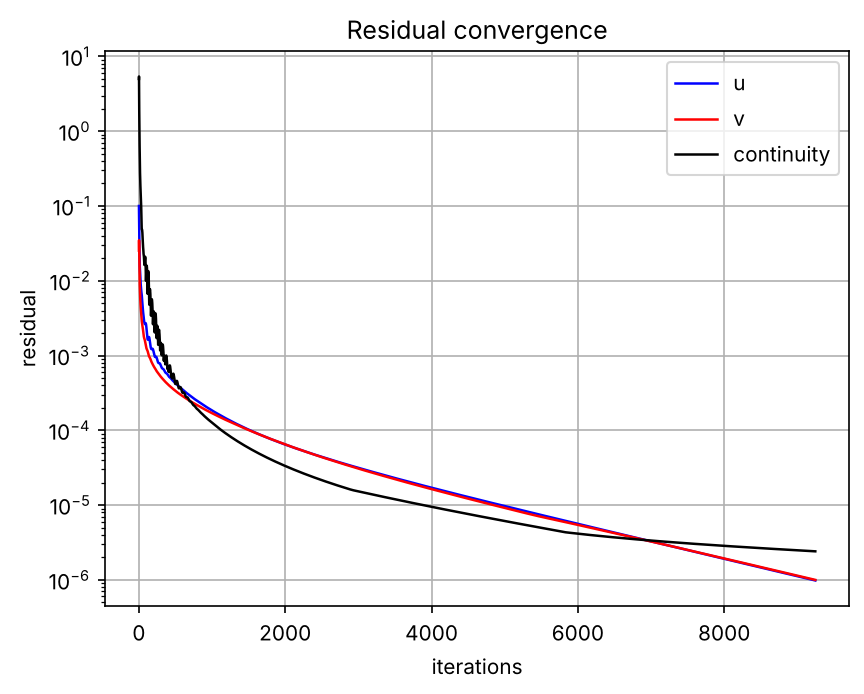
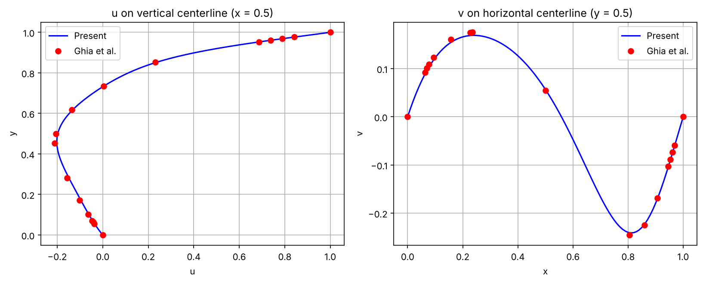

# Theory and numerical method

This document explains the method behind `ldc-cds`: the equations, the grid,
the discretization, the SIMPLE algorithm as implemented, and the validation.
For installation and usage, see the [README](README.md).

Section numbers such as **4.2 (b)** refer to the numbered headings in
[`ldc_cds.py`](ldc_cds.py).

## Contents

1. [Problem](#1-problem)
2. [Governing equations](#2-governing-equations)
3. [Grid](#3-grid)
4. [Discretization](#4-discretization)
5. [The SIMPLE algorithm](#5-the-simple-algorithm)
6. [Pressure-correction solver](#6-pressure-correction-solver)
7. [Convergence and residuals](#7-convergence-and-residuals)
8. [Post-processing](#8-post-processing)
9. [Validation](#9-validation)
10. [Numerical limits](#10-numerical-limits)
11. [Extending the code](#11-extending-the-code)
12. [References](#12-references)

## 1. Problem

A square cavity of side L is filled with fluid. The top wall (the lid) slides
to the right at a constant speed U; the other three walls are fixed. The lid
drags the fluid into one large clockwise vortex, with small counter-rotating
eddies in the two bottom corners.

```
                  u = 1, v = 0   (moving lid)
            +------------------------------+
            |   --->   --->   --->   --->  |
            |                              |
   u = 0    |                              |    u = 0
   v = 0    |        primary vortex        |    v = 0
            |         (clockwise)          |
            |                              |
            |  eddy                  eddy  |
            +------------------------------+
                  u = 0, v = 0
```

With L and U as reference scales, the only parameter is the Reynolds number
Re = UL/ν. The code uses L = 1 and U = 1.

The steady flow is found by marching the unsteady equations in time until the
velocity stops changing.

## 2. Governing equations

Incompressible Navier-Stokes equations in non-dimensional form:

```math
\frac{\partial u}{\partial t} + u\frac{\partial u}{\partial x} + v\frac{\partial u}{\partial y}
  = -\frac{\partial p}{\partial x} + \frac{1}{Re}\left(\frac{\partial^2 u}{\partial x^2} + \frac{\partial^2 u}{\partial y^2}\right)
```

```math
\frac{\partial v}{\partial t} + u\frac{\partial v}{\partial x} + v\frac{\partial v}{\partial y}
  = -\frac{\partial p}{\partial y} + \frac{1}{Re}\left(\frac{\partial^2 v}{\partial x^2} + \frac{\partial^2 v}{\partial y^2}\right)
```

```math
\frac{\partial u}{\partial x} + \frac{\partial v}{\partial y} = 0
```

Boundary conditions: u = 1, v = 0 on the lid; u = v = 0 on the other three
walls (no slip). The pressure correction p' has a zero normal gradient on all
walls.

There is no separate equation for pressure. Its role is to keep the velocity
field divergence-free, and SIMPLE turns that requirement into a Poisson
equation for a pressure correction (section 5).

## 3. Grid

### Layout

The grid is uniform, with spacing h = L/(n − 1), and semi-staggered:

* u and v are stored at the cell corners: an n × n array of nodes;
* p and p' are stored at the cell centers, with one layer of ghost cells
  around the domain: an (n+1) × (n+1) array. Rows and columns 0 and n are the
  ghost cells.

```
   row j-1   o-------------o-------------o
             |             |             |
             |   p[j, i]   |  p[j, i+1]  |
             |             |             |
   row j     o-------------*-------------o      * velocity node [j, i]
             |             |             |      o other velocity nodes
             |  p[j+1, i]  | p[j+1, i+1] |      p pressure cell centers
             |             |             |
   row j+1   o-------------o-------------o
          col i-1        col i        col i+1
```

### Index convention

Arrays are indexed `field[j, i]`, with j the row and i the column. Row 0 is the
lid, so the row index increases **downward**, opposite to y:

| | x | y |
|---|---|---|
| velocity node [j, i] | i·h | L − j·h |
| pressure cell [j, i] | (i − ½)·h | L − (j − ½)·h |

Two consequences:

* the row above row j is j − 1, so a central y-derivative is
  (f[j−1] − f[j+1]) / 2h;
* for plotting, the arrays are flipped with `np.flipud` so that row 0 becomes
  the bottom wall.

### Slices instead of loops

The stencils are evaluated for all interior nodes at once with array slices:

| Slice | Points to |
|---|---|
| `f[1:-1, 1:-1]` | the node itself (j, i) |
| `f[1:-1, 2:]` | right neighbor (j, i+1) |
| `f[1:-1, :-2]` | left neighbor (j, i−1) |
| `f[:-2, 1:-1]` | neighbor above (j−1, i) |
| `f[2:, 1:-1]` | neighbor below (j+1, i) |

So `(u[1:-1, 2:] - u[1:-1, :-2]) / (2*h)` is ∂u/∂x at every interior node. It
is the same arithmetic as a double loop over j and i, run as compiled NumPy
code.

## 4. Discretization

### Convection and diffusion: central differences

At velocity node (j, i):

```math
\frac{\partial u}{\partial x} \approx \frac{u_{j,i+1}-u_{j,i-1}}{2h},
\qquad
\frac{\partial u}{\partial y} \approx \frac{u_{j-1,i}-u_{j+1,i}}{2h}
```

```math
\nabla^2 u \approx \frac{u_{j,i+1}+u_{j,i-1}+u_{j-1,i}+u_{j+1,i}-4u_{j,i}}{h^2}
```

and the same for v. In the y-derivative, row j − 1 comes first because it lies
above row j.

### Pressure gradient at a velocity node

A velocity node is surrounded by four pressure cells. The gradient is the
difference of two face averages (right minus left, top minus bottom):

```math
\frac{\partial p}{\partial x}\bigg|_{j,i} \approx \frac{(p_{j,i+1}+p_{j+1,i+1})-(p_{j,i}+p_{j+1,i})}{2h},
\qquad
\frac{\partial p}{\partial y}\bigg|_{j,i} \approx \frac{(p_{j,i}+p_{j,i+1})-(p_{j+1,i}+p_{j+1,i+1})}{2h}
```

### Divergence in a pressure cell

Pressure cell (J, I) has four velocity nodes at its corners. With the same
averaging:

```math
(\nabla\cdot\mathbf{u})_{J,I} \approx
\frac{(u_{J-1,I}+u_{J,I})-(u_{J-1,I-1}+u_{J,I-1})}{2h}
+ \frac{(v_{J-1,I-1}+v_{J-1,I})-(v_{J,I-1}+v_{J,I})}{2h}
```

### Time stepping

Forward (explicit) Euler: every term on the right-hand side is evaluated at the
old time level n.

## 5. The SIMPLE algorithm

SIMPLE (Semi-Implicit Method for Pressure-Linked Equations, Patankar and
Spalding 1972) splits each time step into a prediction with the old pressure
and a correction that restores continuity. Starting from uⁿ, vⁿ, pⁿ:

**4.1 Momentum predictor.** Advance the momentum equations with the current
pressure,

```math
u^{*} = u^{n} + \Delta t\left[-\left(u\frac{\partial u}{\partial x}+v\frac{\partial u}{\partial y}\right)
       - \frac{\partial p}{\partial x} + \frac{1}{Re}\nabla^2 u\right]^{n}
```

and the same for v\*, then apply the wall boundary conditions to u\* and v\*.
In general u\* does not satisfy continuity.

**4.2 Pressure correction.** Look for a correction p' such that the corrected
velocity

```math
\mathbf{u}^{n+1} = \mathbf{u}^{*} - \Delta t\,\nabla p'
```

is divergence-free. Taking the divergence and setting ∇·uⁿ⁺¹ = 0 gives a
Poisson equation:

```math
\nabla^2 p' = \frac{\nabla\cdot\mathbf{u}^{*}}{\Delta t} \equiv b
```

(a) compute b in every pressure cell; (b) solve for p' (section 6); (c) update
the pressure with under-relaxation:

```math
p^{n+1} = p^{n} + \alpha_p\,p'
```

**4.3 Velocity correction.**

```math
u^{n+1} = u^{*} - \Delta t\,\frac{\partial p'}{\partial x},
\qquad
v^{n+1} = v^{*} - \Delta t\,\frac{\partial p'}{\partial y}
```

using the four-cell gradient of section 4, then the wall boundary conditions
again.

**4.4 Convergence check.** Stop when the largest change of u and v over the
step is below `tol` (section 7).

This is SIMPLE in its explicit, time-marching form: the factor linking the
velocity correction to ∇p' is Δt, rather than the momentum-equation
coefficients used in Patankar's implicit formulation.

## 6. Pressure-correction solver

### Discrete equation

With the 5-point Laplacian, the equation for pressure cell (J, I) is

```math
p'_{J,I} = \tfrac{1}{4}\left(p'_{J+1,I}+p'_{J-1,I}+p'_{J,I+1}+p'_{J,I-1}-h^2\,b_{J,I}\right)
```

It is solved iteratively, starting from p' = 0 at every time step, with
`max_gs` Gauss-Seidel sweeps (50 by default).

### Boundary condition through ghost cells

After every sweep each ghost cell is set equal to its interior neighbor
(`p_prime[0, :] = p_prime[1, :]`, and likewise on the other three sides). This
gives ∂p'/∂n = 0 on all walls and lets every real cell use the same 5-point
formula.

### Red-black ordering

Plain Gauss-Seidel visits the cells one after another, and each update uses
neighbors already updated in the same sweep. That cannot be written as one
array operation. Coloring the cells like a chessboard solves this:

```
   R B R B R
   B R B R B        R: (j + i) even
   R B R B R        B: (j + i) odd
   B R B R B
```

The four neighbors of a red cell are all black, and vice versa. All red cells
are therefore updated at once from the black values, then all black cells from
the new red values; together the two passes make one sweep. It is still
Gauss-Seidel, with a different visiting order, and for this equation it
converges at the same rate.

## 7. Convergence and residuals

Three quantities are recorded at every step:

| Name | What it measures |
|---|---|
| `res_u` | largest change of u over one time step |
| `res_v` | largest change of v over one time step |
| `res_cont` | largest divergence of the predicted velocity u\*: the mass imbalance that the pressure correction has to remove |

The run stops when both `res_u` and `res_v` are below `tol`.

**`tol` depends on Δt.** The change over one step is about Δt·|∂u/∂t|, so the
test is effectively |∂u/∂t| < tol/Δt. Halving Δt doubles the rate of change
that still counts as converged. To compare runs with different time steps at
the same level of convergence, scale `tol` with Δt; `tol = 1e-3 * dt`
reproduces the default.

<p align="center">
  
</p>

**Continuity residual floor.** In the default run, the u and v residuals keep
falling while the continuity residual levels off near 2 × 10⁻⁶. The leftover
divergence flips sign from one cell to the next: averaging it over 2 × 2 cells
makes it 13 times smaller. On this grid, a checkerboard pattern in p' has zero
gradient at every velocity node:

```math
p'_{J,I} = (-1)^{J+I}
\;\;\Rightarrow\;\;
\frac{\partial p'}{\partial x}\bigg|_{j,i} = \frac{\partial p'}{\partial y}\bigg|_{j,i} = 0
```

so the part of the mass imbalance that maps onto such a pattern cannot be
removed by the velocity correction. This is the odd-even (checkerboard)
decoupling known for non-staggered and semi-staggered grids, a property of the
grid arrangement rather than a bug. The floor is small, and the velocities
still agree with the benchmark to within 0.01 (section 9).

## 8. Post-processing

### Streamfunction and streamlines

Since u = ∂ψ/∂y, ψ is obtained by integrating u up each column from the bottom
wall, where ψ = 0, with the trapezoidal rule:

```math
\psi_{k} = \psi_{k-1} + \frac{h}{2}\left(u_{k}+u_{k-1}\right), \qquad \psi_{0} = 0
```

where k counts rows upward from the bottom wall (the flipped arrays).
Streamlines are contours of ψ. The primary vortex reaches about ψ = −0.1, while
the corner eddies are several orders of magnitude weaker, so three groups of
contour levels are used: values close to zero near the walls, `n_main` evenly
spaced values down to the vortex center, and small positive values for the
eddies. Contouring a smooth ψ gives closed, unbroken streamlines. Seed-based
tracers such as `plt.streamplot` often stop in the slow corners.

Arrowheads are placed along each contour line every `arrow_spacing` of arc
length, pointing along the local velocity, which is tangent to the streamline.

### Velocity vectors

Every s-th node is sampled, so that about `n_vectors` arrows span the cavity.
Arrow length is proportional to |V|, with one scale for all arrows: the fastest
arrow is `arrow_gain` times the arrow spacing.

### Centerline profiles

u is taken along the grid column at x = L/2 and v along the grid row at
y = L/2. These are exact center lines when n is odd. The profiles are then
interpolated linearly onto Ghia's sample points.

## 9. Validation

Ghia, Ghia and Shin (1982) solved this problem on fine grids (129 × 129 at
Re = 100) and tabulated u along the vertical centerline and v along the
horizontal centerline. These tables are the standard benchmark for cavity
solvers.

<p align="center">
  
</p>

Settings: Re = 100, Δt = 0.001, tol = 10⁻⁶, 50 Gauss-Seidel sweeps,
α_p = 0.7.

| Grid | Steps to steady state | Max error in u | Max error in v |
|---|---|---|---|
| 51 × 51 | 9165 | 0.0209 | 0.0163 |
| 101 × 101 | 9245 | 0.0094 | 0.0068 |
| 129 × 129 | 9261 | 0.0069 | 0.0048 |
| 151 × 151 | 9269 | 0.0056 | 0.0038 |

The error decreases steadily with grid refinement. On the 129 × 129 grid,
Ghia's sample points fall exactly on grid nodes, so no interpolation is
involved. The error does not go to zero, because Ghia's values are themselves
a numerical solution on a 129 × 129 grid. To reproduce a row, set `n` in
section 1 of `ldc_cds.py` and run the script (n ≤ 159 at Δt = 0.001; see
section 10).

## 10. Numerical limits

**Cell Reynolds number.** Central differencing of the convective terms stays
free of oscillations only if Re·h ≤ 2. With L = 1 this means n ≥ Re/2 + 1:

| Re | Minimum n |
|---|---|
| 100 | 51 |
| 400 | 201 |
| 1000 | 501 |

The script does not check this, so check it before changing Re or n. Upwind
schemes remove this limit at the cost of numerical diffusion (section 11).

**Time step.** The explicit treatment of diffusion is stable only for

```math
\Delta t \le \frac{Re\,h^2}{4}
```

At the default Δt = 0.001 and Re = 100, this allows n up to 159. Finer grids
need a smaller Δt, and therefore more steps. If the limit is exceeded, the
solution blows up: the printed max change grows to inf or nan. Stop the run
with Ctrl+C and reduce Δt.

**Convergence test.** `tol` acts on the change per step, which scales with Δt;
see section 7.

**Pressure sweeps.** p' is not solved to convergence at every step, so the
intermediate time steps are not an accurate transient. Only the steady state is
meaningful.

**Speed.** Pure NumPy: about a minute for 101 × 101 at Re = 100. The cost per
step grows as n², and finer grids also need smaller time steps.

## 11. Extending the code

| To change | Where in `ldc_cds.py` | Notes |
|---|---|---|
| Reynolds number, grid, time step | section 1: `re`, `n`, `dt` | Keep within the limits of section 10, and keep n odd |
| Convection scheme (upwind, hybrid, QUICK) | section 4.1: `dudx, dudy, dvdx, dvdy` | Upwind schemes remove the Re·h ≤ 2 limit but add numerical diffusion |
| Pressure solver | section 4.2 (b) | Over-relaxation (SOR) needs far fewer sweeps. The p' matrix never changes on this grid, so it can also be factorized once with `scipy.sparse.linalg.splu` and solved with one back-substitution per step |
| Benchmark data for another Re | section 5.3: `x_ghia, y_ghia, u_ghia, v_ghia` | Copy the values from Ghia's Tables I and II. `data/ghia_1982_re100.csv` holds the Re = 100 values in the same layout |
| New figures | section 5: a new block after 5.4; section 6: add it to `figures` | |
| Output folder and files | section 1: `out_dir`; section 6 | |
| Grid-convergence study | change `n` in section 1 and run once per grid | Each run prints its Ghia errors at the end |

After any change to the numerics, run the default case and check that the
printed Ghia errors are still 0.0094 and 0.0068 (101 × 101 grid).

## 12. References

1. U. Ghia, K. N. Ghia and C. T. Shin, "High-Re solutions for incompressible
   flow using the Navier-Stokes equations and a multigrid method", *Journal of
   Computational Physics* 48 (1982) 387–411.
   doi:[10.1016/0021-9991(82)90058-4](https://doi.org/10.1016/0021-9991(82)90058-4)
2. S. V. Patankar and D. B. Spalding, "A calculation procedure for heat, mass
   and momentum transfer in three-dimensional parabolic flows", *International
   Journal of Heat and Mass Transfer* 15 (1972) 1787–1806.
3. S. V. Patankar, *Numerical Heat Transfer and Fluid Flow*, Hemisphere, 1980.
4. H. K. Versteeg and W. Malalasekera, *An Introduction to Computational Fluid
   Dynamics: The Finite Volume Method*, 2nd ed., Pearson, 2007.
5. J. H. Ferziger and M. Perić, *Computational Methods for Fluid Dynamics*,
   3rd ed., Springer, 2002.
